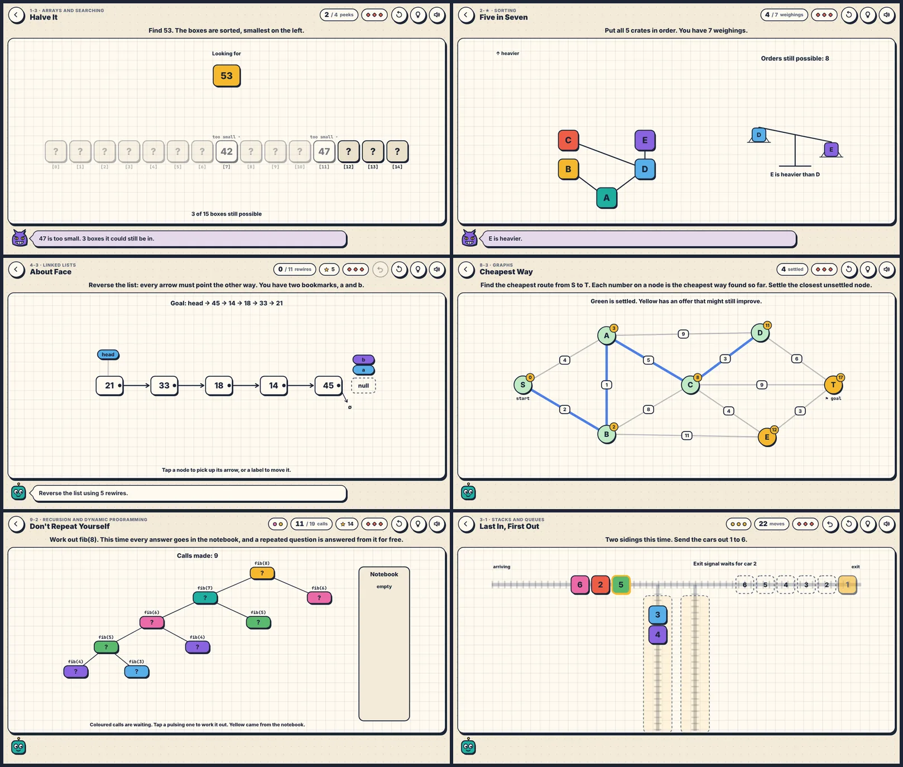

# Bit by Bit

**You are the algorithm.** A browser game that teaches data structures and
algorithms by putting them in your hands: 34 small puzzles, from the first
array to dynamic programming. Each one gives you a structure, a rule and a
budget. The strategy that fits the budget is the textbook algorithm, and the
game only tells you its name, its cost and its code after you have found it.

Your opponent is **Murphy**, who makes whatever can go wrong go wrong. He has
not hidden the number in any box until he sees where you look, so the only
way to find it in four peeks is to halve the row every time. That is what
"worst case" means, and the game lets you feel it before it says so.



More views: [the map](preview/map.webp) · [a lesson card](preview/detail-lesson-card.webp) ·
[watching an algorithm run](preview/detail-demo.webp) · [phone](preview/phone.webp).

| | |
| :--- | :--- |
| **Play it** | open [`index.html`](index.html): no install, no server, no network, about 245 KiB |
| **Model** | Claude Fable 5.2, medium reasoning (Claude Code, cloud session) |
| **Brief** | [`brief.md`](brief.md): one human turn during the run, and six after delivery about metadata, collection tooling and review |
| **Wall clock** | about 60 working minutes, in two sittings |
| **Process** | [`process/PROGRESS.md`](process/PROGRESS.md), [snapshots](process/snapshots/) |

## Play

Open `index.html` in a current browser. Everything is tap or click; a
keyboard works too (<kbd>Tab</kbd> and <kbd>Enter</kbd> on the stage,
<kbd>H</kbd> hint, <kbd>Z</kbd> undo, <kbd>R</kbd> restart). Progress is
kept in the browser's local storage and nowhere else.

- **Three stars** for solving a level within its par, with no mistakes and
  no hints. Any finish unlocks the next level. Settings can unlock
  everything, switch the light and dark sheets, and mute the sound.
- **Hint** shows the next move of the textbook algorithm and why.
- **Watch it run**, on any win or loss card, replays the whole algorithm on
  your puzzle with each step explained and the matching line of code lit.
- **New puzzle** deals a fresh instance of most levels.
- **Notebook** collects every idea you have met, with its code, and a ladder
  of growth rates from O(1) to O(2ⁿ).

## The curriculum

| | World | Levels | What you do, and what it turns out to be |
| :-- | :-- | :-- | :-- |
| 1 | The Lockers | 5 | open lockers by number (indexing, O(1)); hunt through unsorted boxes (linear search); halve a sorted row in four peeks (binary search); corner one number in a million in twenty guesses (logarithms); slide tiles to make room (array insertion, O(n)) |
| 2 | The Sorting Floor | 5 + 1 | swap neighbours and count inversions (bubble sort); swap anything in the fewest moves (selection sort); find the heaviest of eight crates in seven weighings (a lower bound); merge runs (merge sort); choose pivots to stay under 34 comparisons (quicksort); optional: sort five crates in seven weighings |
| 3 | The Siding | 3 | reorder trains with dead-end sidings (stacks); be a bracket matcher; serve a café queue from two stacks at one flip per order (amortized cost) |
| 4 | The Chain | 3 | follow addresses through scattered memory (list traversal); splice and delete by rewiring arrows, where anything nothing points to is garbage collected; reverse a list with two bookmarks |
| 5 | The Coat Check | 3 | hang coats by last digit and find them in the dark (hashing); resolve collisions by walking right (linear probing); be Murphy and build a table that takes six looks (worst-case input) |
| 6 | The Orchard | 4 | route keys left and right (search-tree insert); choose an insertion order that keeps the tree short (balance); walk it three ways (traversals); fix a lopsided tree with rotations |
| 7 | The Pecking Order | 2 | let a new value climb a heap; empty a heap by sinking, and get heapsort |
| 8 | The Map Room | 5 | explore in rings with a queue (BFS) and down rabbit holes with a stack (DFS); settle the closest node first (Dijkstra); make breakfast in a valid order (topological sort); wire eight towns as cheaply as possible (minimum spanning tree) |
| 9 | The Hall of Mirrors | 3 | the tower puzzle (recursion, 2ⁿ); a Fibonacci call tree with and without a notebook (memoization); the richest path through a grid, by instinct and then by table (dynamic programming) |

## How it is made

No build and no dependencies: classic scripts and one stylesheet, about
3,300 lines.

| File | What it is |
| :-- | :-- |
| [`src/core.js`](src/core.js) | the contract every puzzle follows, seeded randomness, star scoring |
| [`src/logic/`](src/logic/) | the 22 puzzle types as pure state machines: `init`, `act`, `hint` |
| [`src/levels.js`](src/levels.js) | the curriculum: every lesson, tip, lesson card and code listing |
| [`src/dom.js`](src/dom.js), [`src/draw.js`](src/draw.js) | a small keyed SVG renderer and the shapes views are built from |
| [`src/views/`](src/views/) | one function per puzzle type, from state to stage |
| [`src/app.js`](src/app.js) | map, play screen, cards, hints, the demo player, notebook, saved progress |
| [`src/audio.js`](src/audio.js) | synthesized sounds; pitch follows value, so a sorted row is a rising scale |

Three ideas carry it:

- **One policy, four uses.** Each puzzle's `hint(state)` returns the next
  move of the textbook algorithm with a sentence of explanation and a line
  number in the code shown on the lesson card. The hint button shows one
  move; "Watch it run" plays them all; the tests follow them to prove every
  level can earn three stars; the browser verifier clicks them.
- **Murphy is computed, not scripted.** The search levels keep only the set
  of places the target could still be, and answer each peek to keep that set
  as large as possible while inventing values that stay consistent. The
  scale counts the orderings still compatible with every result so far and
  gives whichever answer leaves more. So "you cannot beat four peeks" and
  "five crates need seven weighings" are things the tests check exhaustively
  rather than things the text asserts.
- **State is plain JSON.** Undo is a stack of snapshots, a fresh puzzle is a
  new seed, and the page and Node run the same files.

## Reproduce

```bash
node --test tests/*.test.js     # 85 tests of the puzzle logic (one runs a listing in python3)
```

```bash
(cd ../.. && pnpm install --frozen-lockfile) && node verify.mjs
```

`verify.mjs` needs current Google Chrome (see the root README, or set
`CHROMIUM_PATH`). It opens the page from disk, plays every level to its
lesson card with real mouse clicks on the page's own controls, and checks
hints, undo, losing, the demo, saved progress, and that nothing is drawn off
the stage at desktop, phone and tablet sizes. `node tools/shoot.mjs out_dir
"1-3:hh" map` takes development screenshots.

## Process notes and limitations

The agent's own account; the full log is in
[`process/PROGRESS.md`](process/PROGRESS.md).

**Checked.** Every level is solvable for three stars by its own hint policy
on 40 seeds each, and survives random play. No sequence of three peeks finds
the number among fifteen boxes (all 2,730 tried), and every value Murphy
reveals stays consistent. A search over every weighing strategy confirms
seven weighings sort five crates and six cannot. The pars for selection
sort and for tree rotations are true minimums, by breadth-first search. In
Chrome 156 all 34 levels were won with real clicks, 465 in total. That
verifier found two controls that swallowed taps and one element drawn off
screen on phones, all fixed.

**Not checked.**

- Nobody has played it at human speed. Pacing, difficulty, and whether the
  explanations work for a real learner are the agent's guess. The lesson
  texts were written once.
- The sound was never heard: the run had no audio output.
- Only Chrome was run. Moving lines animate through the CSS `d` property;
  in a browser without it they jump while the tiles slide.
- The real-click playthrough runs at 1280 x 720. At phone and tablet size
  only layout bounds are checked. Rows of fifteen tiles are small on a
  narrow phone.

**Weaker spots.** A few levels are drills more than puzzles: the heap,
traversal and bracket levels ask you to apply a rule you have just been
told. Graph levels other than the two searches and the spanning tree use one
fixed graph each. Big-O is taught by feel and by one table, without any
formal definition. There is no level on tries, union-find, balanced-tree
insertion or backtracking.
