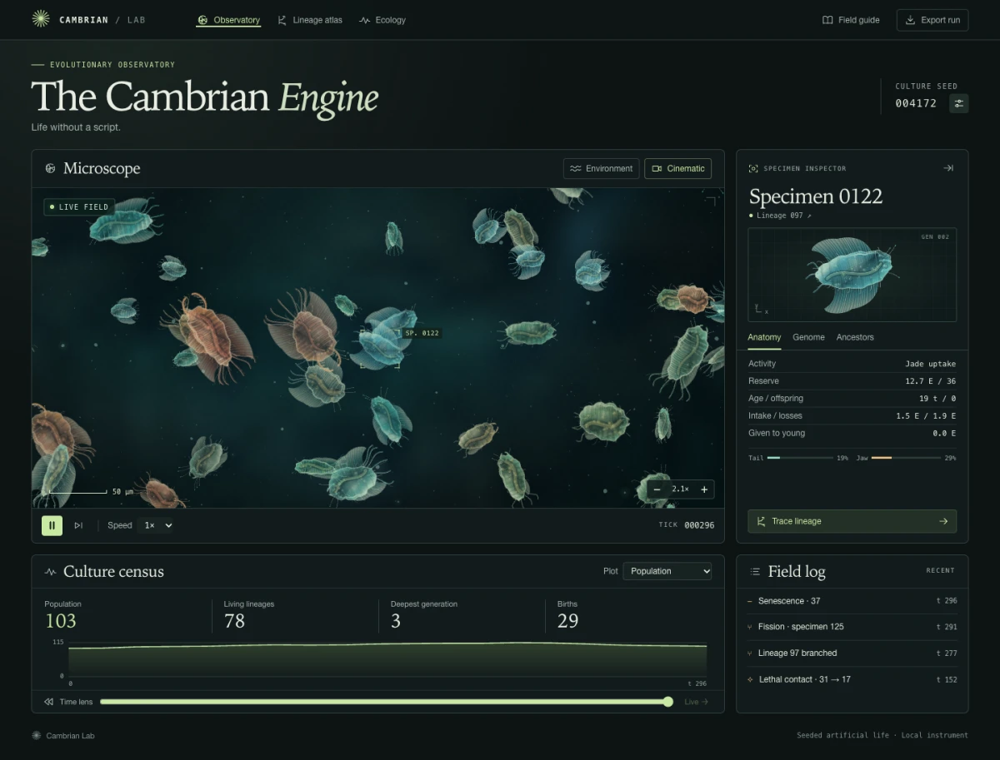

# The Cambrian Engine

**[Open the observatory](index.html)** by double-clicking `index.html` in a local checkout. The microscope, lineage atlas and laboratory work offline. The opening field is seed 4172 after 296 simulated ticks. A new culture starts at tick zero.



**Try the habitat study.** Open **Field guide → Open mosaic study**. A second tab reconstructs seed 73 at tick 14,400. Each point plots one living organism's gut chemistry against the original jade share of its current patch. Click a point to meet the animal. **Trace lineage** opens its founder family. Pick a branch and **Revisit origin** to see the first organism carrying that branch label.

## Operating the instrument

| Control | What it measures or changes |
| --- | --- |
| Click an organism, or use the inspector’s next arrow | Follow an individual. Its plate shows the inherited body, current activity, reserve, age, number of offspring and lifetime energy flows. Genome lists all 27 normalized loci. Ancestors links to actual birth ticks. |
| Drag the field, use the lens buttons, or scroll | Pan across the periodic chamber or change the magnification. The ruler measures positions. Specimens are enlarged for visibility. The plate fits each body individually. |
| Pause, step, speed | Stop on a state, advance one tick, or request up to 64× speed. Space toggles playback outside controls. One nominal speed is 15 ticks per second. |
| Cinematic | Expand the field and follow living participants in recent branching, feeding and birth events. Captions give the recorded event tick. Escape exits the camera mode. |
| Culture census, time lens, field log | Plot the population, living branches, maximum genealogical depth or Shannon entropy. Scrub to reconstruct any past tick. Click a log entry to watch the interval around it. Live returns to the original culture. |
| Lineage atlas | The horizontal axis is time. A junction marks a daughter branch, a dot a living branch, and a cross the end of direct membership. Choose a founder, page through branches, trace a parent or locate a living member. |
| Environment, then Ecology | Change the renewal mix. The first intervention retains a second world with identical prior history. Both advance for the same number of ticks. Compare population and gut chemistry, inspect the habitat plot or replay a recorded lethal feeding link. |
| Seed control, Export run | Start a chosen seed with mutation enabled or disabled. Export captures the engine digest, initial settings, action times, census, budget, inspected specimen and paired control recipe. |

## What evolves

Ninety-six founders receive independently sampled genomes. A body’s size sets its reserve capacity. Tail length, aspect, fins and armor change propulsion, drag and turning. Gut chemistry changes the uptake efficiency of the two substrates. Jaws alter the trade-off between grazing and grabbing tissue. Armor and spines reduce the amount extractable on contact.

At each tick an individual samples local chemistry, a left–right gradient, hunger and the closest neighbor's bearing and proximity. Signed inherited weights map these inputs to turning, thrust, grazing and grasping effort. Two organisms sensing the same neighbor can turn in opposite directions. Motion is continuous on a 960 × 600 torus. A spatial grid limits neighbor searches. The rendering samples actual positions, orientations, morphology and resource stocks.

A mature individual can divide when its reserve exceeds its inherited reproduction threshold. The parent supplies the offspring’s energy and pays a separate reproductive cost. The offspring inherits a copy of the genome. With standard mutation, each locus has a 0.23 chance of a bounded perturbation. The model reflects values at the allele boundaries. Death follows exhaustion or senescence. Food access, extraction costs, encounters and reproduction determine which genomes persist. An extinct culture stays extinct.

The chamber holds jade and amber substrates in 40 × 25 resource cells. Each cell’s combined target is 3.2 energy units. Cells replenish 2.2% of deficits and lose 3.5% of surpluses per tick. Interventions alter the target composition, letting the existing stock change over time. The energy invariant is

```text
jade stock + amber stock + living reserves
= initial stored energy + cumulative renewal − metabolic/conversion losses − spoilage
```

Reproduction transfers reserve between organisms. The birth cost is a loss. A successful bite transfers energy from prey to consumer with conversion loss. Unused reserves at death leave the chamber through spoilage. The artificial energy unit is **E**.

## What the experiments found

- **Two feeding types occupied different patches.** At tick 14,400, five of six mutation-enabled balanced cultures survived. All five held organisms in both outer thirds of the gut locus. Low-gut organisms occupied patches whose initial jade share was, on average, **27.27 percentage points higher** than the patches occupied by high-gut organisms. Seed 31 went extinct. Two of six mutation-disabled cultures retained both groups. [Mosaic measurements](experiments/mosaic.json)
- **The gut locus accounted for the home-environment advantage.** After 4,800 ticks of selection in jade-rich or amber-rich water, a reciprocal assay placed 48 sampled founders into each fresh garden with mutation off. Across six training seeds and two placements, home-grown populations averaged **6.683 more living organisms per starting founder** at tick 360. Training without mutation yielded **2.577**. Equalizing the gut locus in both evolved pools reduced the difference to **−0.048**. [Assay design and per-seed results](experiments/README.md)
- **Specialization carried a cost.** Two of six amber-trained cultures went extinct after the supply switched to jade. Their constant-amber controls survived. Lethal contacts and prey-energy transfers occurred, but prey contributed less than 0.5% of late intake in the mutation-enabled fixed-environment trials. These observations support grazing specialization. Persistent predator guilds, cooperation and intelligence remain unestablished. [Selection and pulse measurements](experiments/ecology.json)
- **One pedigree spans 2,548 generations.** Seed 73 ran for 620,000 balanced ticks, produced 400,636 births and finished with 270 living organisms. The verifier followed 2,548 consecutive parent-child links from a living organism back to its founder. The largest sampled energy residual divided by total energy supplied was 2.08 × 10⁻¹². [Long-run receipt](experiments/stability.json)

## Reproduce

Use Node 24. No runtime dependencies are required. From this directory:

```sh
node --test tests/*.test.cjs
node build.cjs
node build.cjs --check
node lab.cjs --seed 73 --ticks 14400 --environment balanced --sample-every 120 > output/census.json
node lab.cjs --replay chamber-export.json > output/replayed.json
node lab.cjs --replay chamber-export.json --control > output/control.json
```

The build writes the entire playable instrument to `output/cambrian-engine.html`. Give that file to someone to play offline. The final two commands use an **Export run** download. The control command applies to a run with a recorded environmental intervention. All measurements can be regenerated separately. [Experiment commands](experiments/README.md)

For browser verification, install the collection’s locked tools with `pnpm install --frozen-lockfile` at the repository root and use current Google Chrome. From the run directory:

```sh
node verify.mjs
node tests/cross-runtime.mjs
```

The first command drives the source page and standalone file offline, exercises controls, compares actual downloaded records with CLI replay, and saves local screenshots to `output/playwright/`. The second compares serialized Chrome and Node states through tick 27,000, including substrate stocks, living bodies, lineages and the ledger. The renderer can vary with GPU, pixel density, system fonts and display timing.

## Performance and limits

On an Apple M4 with Node 24.22.1, three warmed runs of 18,000 ticks measured median batch means of **0.113–0.152 ms per tick**, with 50–392 organisms at sample points. The 620,000-tick run spent 72.7 seconds stepping the engine. Retained pedigree and clade records scale with births. Peak sampled process RSS reached **487 MiB** in that run. The interactive time lens rebuilds from the seed in interruptible batches, so distant history takes longer to open. The live notebook periodically thins census samples and bounds its event list. [Benchmarks and profile](experiments/README.md)

The model uses asexual reproduction, fixed-length genomes, a fixed sensor and actuator layout, two soluble foods and a single energy currency. Gene combinations, controller weights and ecological outcomes can vary. New organ types require new model mechanisms. Branch labels mark an RMS genetic distance of at least 0.11 from the current branch founder after at least two generations. They carry no reproductive-isolation claim. The simulation treats bodies as centers with effective interaction radii. The optical layer enlarges those bodies, so overlapping artwork can extend beyond physical contact. The micrometer ruler adopts one micrometer per coordinate unit as a display convention. Time and energy have no empirical calibration. Suspended dust and caustics are optical decoration.

[Source model](engine.js) · [Microscope renderer](optics.js) · [Time and paired worlds](record.js) · [Plots](plots.js) · [Interface](station.js) · [Verbatim brief](brief.md) · [Development log](process/PROGRESS.md) · [Numbered screenshots](process/snapshots/)
