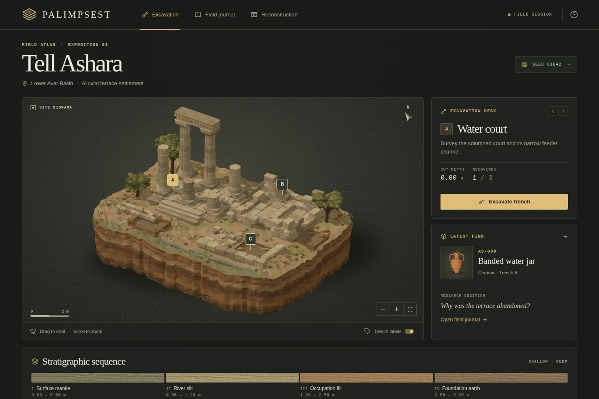

# Palimpsest

Tell Ashara grew on an alluvial terrace in the Lower Avar Basin. A banded water jar survives on the surface. Below it lie the traces of a grain economy, a changing river, and the decisions of the last households to live here.



## Play

Open [index.html](index.html) from a local checkout in a current browser with WebGL enabled. All scripts, styles, geometry, surface textures, and specimen plates are local. The featured expedition uses seed **1842**. Use the seed control to explore another history of the basin.

1. Select a trench marker or use the arrows on the excavation desk. Drag to orbit the site and scroll to zoom. The focused model also accepts left and right arrow keys.
2. Excavate a trench. Brush across the exposure with a pointer, or use **Brush a pass**. Lift the object once enough of its surface is clear. Escape closes the exposure without collecting it.
3. Inspect the object, magnify its surface, and read its stratigraphic context. Each record includes an expandable link to the exact historical event and its causes.
4. In **Field journal**, choose an environmental pressure and a departure pattern, cite your finds, and save the hypothesis.
5. Play **Reconstruction** or select individual event ticks. The last event compares both claims and their cited evidence with the ledger. The replay reveals the mystery, so the field investigation can come first.

Progress saves in browser storage for each seed when available. Moving a file, switching browser profiles, or disabling storage can affect persistence.

## Reproduce

From this directory, with Node 24:

```sh
node tools/bundle.mjs
node tools/bundle.mjs --check
node --test tests/history.test.cjs
```

The build emits **output/palimpsest.html**, a single file that can be copied and opened offline. It embeds the same source, CSS, and renderer as the direct-file entry. The vendored renderer is the MIT-licensed classic build of Three.js 0.159.0. Its license is preserved in both editions. The run uses no downloaded models, environment maps, textures, fonts, or illustrations.

For an end-to-end check, install the collection's locked dependencies with `pnpm install --frozen-lockfile` at the repository root, build the standalone edition, and run `node tests/browser.mjs` here. The check uses the collection's version-checked Chrome launcher. Set `CHROMIUM_PATH` to a supported Chrome executable when needed. It plays through excavation, tests cancelled and completed recoveries, opens provenance, saves a cited interpretation, advances replay, changes seeds, checks a narrow viewport, and opens the standalone edition in a fresh offline context. Screenshots go to ignored `output/`.

## How a history becomes a site

- **Settlement.** A seeded integer generator sets rainfall, channel gradient, clay availability, and founding population. Five-year steps update water, grain, population, and trade. Storehouse construction requires surplus. Quay construction requires a larger surplus. The columned court requires accumulated trade.
- **Pressure.** Low-gradient channels lose flow as silt accumulates. Steeper catchments face a late rainfall decline. Low water stops trade and triggers intake repairs. Sustained shortage reduces population and causes households to dismantle and leave.
- **Material record.** A historical event identifies its constructed fabric or deposited object, place, date, and prior causes. The transformation partitions the ledger into dated horizons. Deposition duration and material determine thickness, and an object's position within its horizon determines its reference depth. Exposure, use duration, and cover affect surviving wall courses. The section compresses burial depth vertically for legibility.
- **Investigation.** The survey has already catalogued the latest surface object. Every further lift must follow local depth order. The journal stores citations to individual finds. Direct evidence for environmental pressure and departure is identified in the end comparison.
- **Replay.** Each scene filters the same construction records by event date. Population, crops, boats, water, standing fabric, and later dismantling reflect that point in the ledger. The modern survey shows the eroded remains after abandonment.

The simulation tests exercise the production `simulate` function. They sweep seeds 0–255 and a second deterministic sample across the unsigned 32-bit range, including limits and both featured outcomes. Checks cover reproducibility, event order, causal pointers, resource thresholds, structure provenance, object provenance, deposition dates, depth bounds, adjoining strata, and abandonment.

## Process notes and limitations

The first playable prototype exposed the ledger-backed site with one excavation button. Browser inspection led to a larger model, actual trench cuts, manual brushing, illustrated records, and a second pass on the inhabited architecture. Broader testing caught a marginal seed that exhausted river traffic too early. The dated log and numbered captures preserve the iterations. [Progress log](process/PROGRESS.md) · [Snapshots](process/snapshots)

This is one settlement tradition with three trenches, eight recoverable records per run, and two environmental trajectories. Seeds vary timing, resources, burial depths, preservation, vegetation, and erosion within that tradition. Building plans and object types follow authored rules. A horizon represents a site-wide reference sequence; the model does not simulate sediment transport or local disturbances at grain scale. The replay visits recorded events rather than animating every household between them. The grain and population model is fictional, with no claim to reconstruct a particular real culture.

The 3D renderer was exercised in desktop Chromium and a simulated narrow viewport. Physical touchscreen devices and Safari were not tested. If WebGL is unavailable, the desk arrows, brushing, catalogue, and text replay remain usable.
