# THRESHOLD: An Infinity of Elsewheres

A first-person walk through an unbounded, procedurally generated multiverse
whose worlds are joined by real portals: windows you can look through from any
angle, stand halfway inside, and walk through and back without a seam. You
begin on a stone deck suspended above an endless ocean at dawn; ahead, through
a doorway thirty-two metres tall, a desert lies under three moons. Beyond it:
a forest that glows, a frozen megastructure, a room that contains itself, a
hall larger than the cell that holds it, a stoa that never ends, and then a
lattice of generated worlds that does not stop.

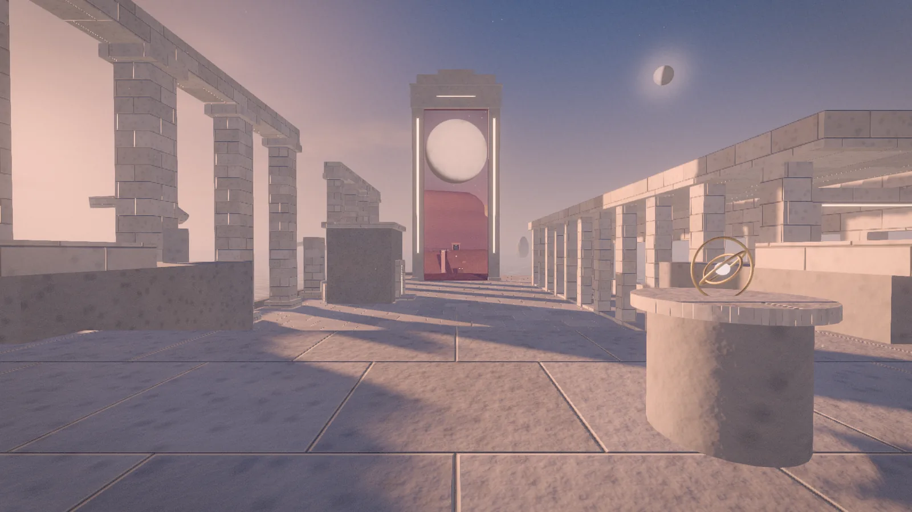

| | |
| :--- | :--- |
| **Model** | Claude Opus 5.5 (Claude Code, cloud session) |
| **Brief** | [`brief.md`](brief.md), 1 human turn |
| **Wall clock** | 7 h 14 min (12:36 to 19:50 UTC), including a usage-limit pause of about 4 h; about 3 h 13 min of work |
| **Full-size outputs** | release `run-threshold`: the demo film, `threshold_demo.mp4` |
| **Process** | [`process/PROGRESS.md`](process/PROGRESS.md), [snapshots](process/snapshots/) |

| | |
| :--- | :--- |
| 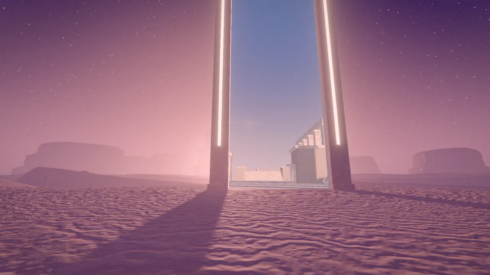 | 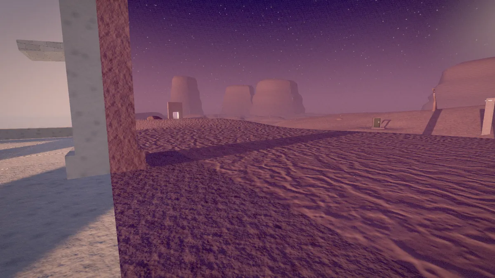 |
| *Ashmere: turn round, and the Threshold is behind you.* | *Standing in the doorway, 2.5 cm from the plane.* |
| 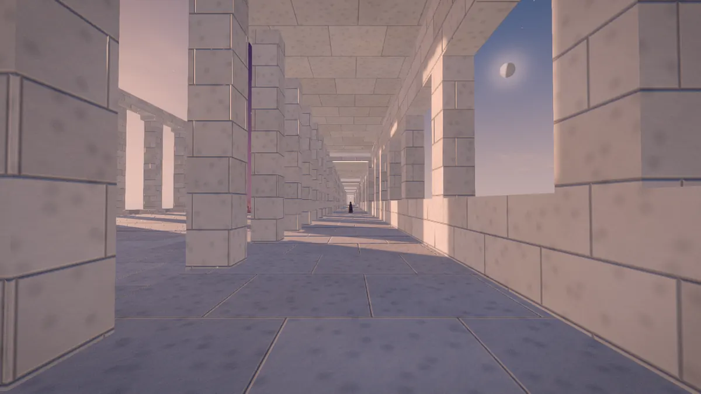 | 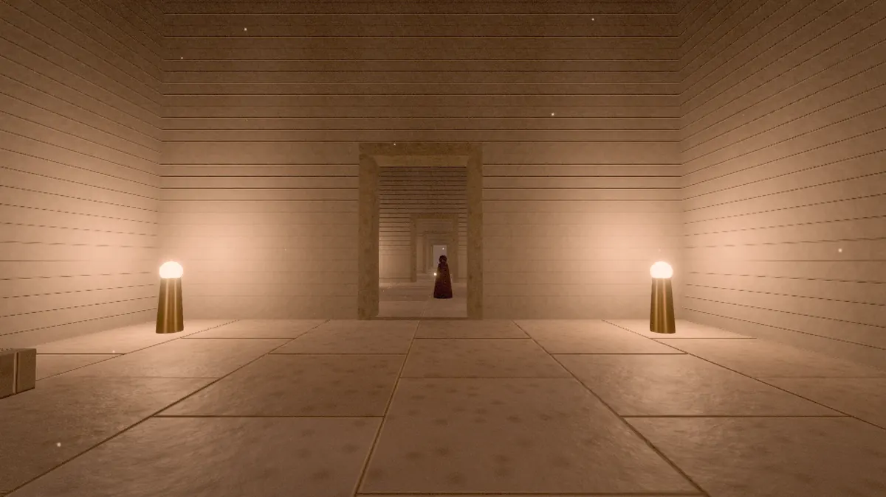 |
| *The Endless Stoa. The figure far ahead is you.* | *The room that contains itself, with you in it.* |
| 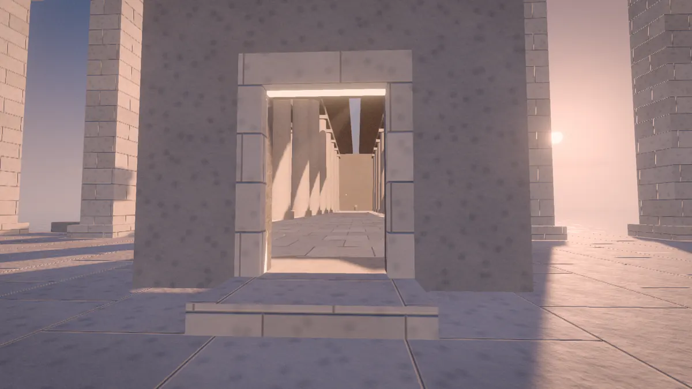 | 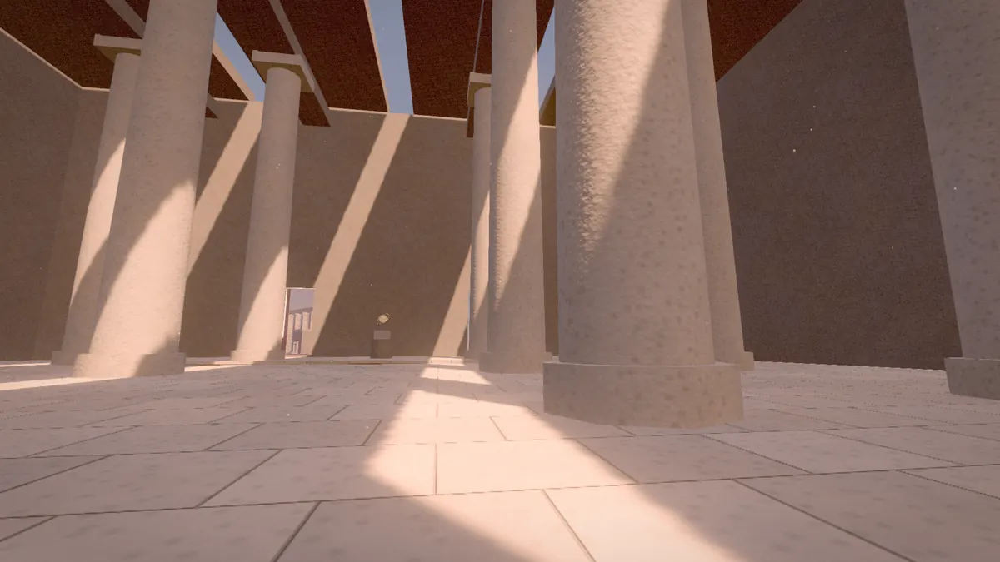 |
| *The Cell, seven metres across, opens into…* | *…the Inner Hall, 160 m long.* |
| 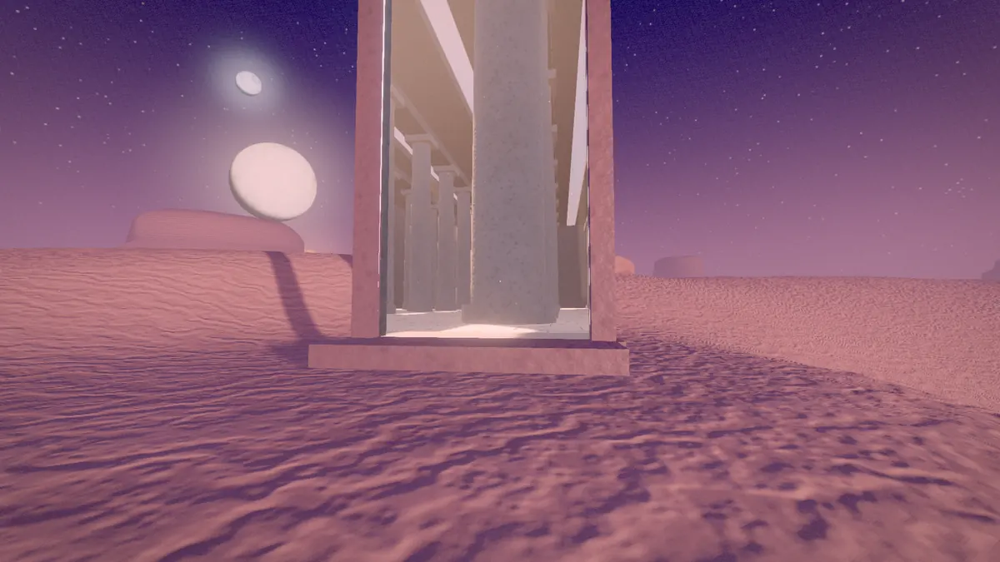 | 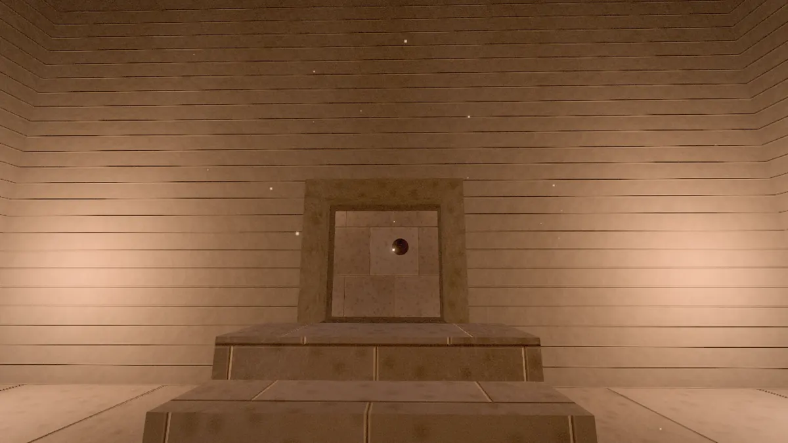 |
| *A window standing in the dunes.* | *The window that opens through the room's own ceiling.* |
| 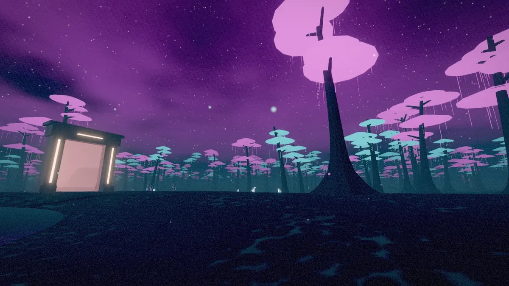 | 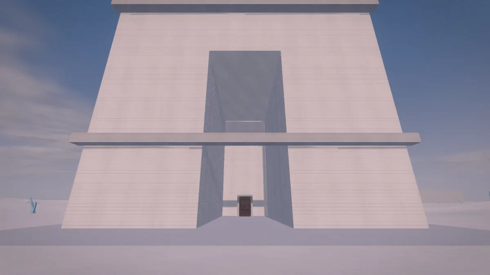 |
| *Velloria.* | *Isenholm, and the door at the foot of the Vault.* |

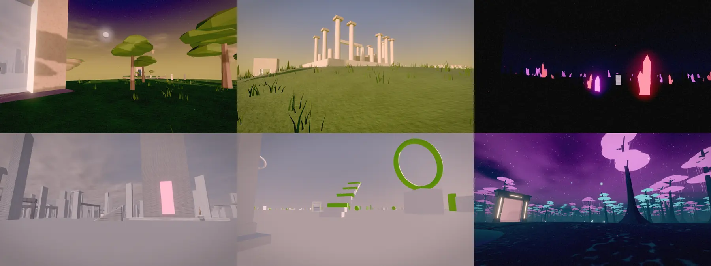

*Generated worlds: an archipelago, temple ruins, a crystal cavern, the endless
brutalist grid, the geometric void, and the curated forest for comparison.*

## Play it

ES modules cannot load from `file://`, so serve the directory (no install,
three.js is vendored):

```bash
node tools/serve.mjs          # then open http://127.0.0.1:8737/
# or: python3 -m http.server 8737
```

**Controls.** Mouse to look (click to capture the pointer), W A S D to walk,
Shift to run, Space to jump, E to touch (take the instrument, wake a
lodestone), Q to raise the instrument, J for the journal, Esc to pause,
`` ` `` for diagnostics (N then toggles noclip).

**Address bar options.** `?demo` the cinematic demo; `?bench` measure fixed
scenes on your machine; `?quality=0..4` pin the quality (otherwise it adapts);
`?fresh` forget the saved journey; `?universe=N` a different multiverse;
`?mute`; `?nolock` look by dragging instead of pointer lock.

The title screen also offers *Watch the journey* (the demo). Everything you
discover is saved in the browser's local storage.

## What there is

**The opening.** You start on a terrace above the deck of the Threshold, a
monumental platform suspended over the sea, sixty metres up. A colonnade on
the left and a roofed stoa on the right lead the eye to the great doorway; the
low sun behind it lays the pillars' shadows across the deck. Through the
doorway, in another world, three moons rise over twilight dunes. On a pedestal
beside you hums an instrument; the interface teaches only what you need, one
line at a time (look, walk, take, raise), and then leaves you alone. Walk to
the door and the desert grows naturally in it; step through and turn round,
and the dawn platform is behind you, framed by the same door.

**The curated worlds** (lattice cells (0,0) to (3,0) and two pockets):

- *The Threshold* (0,0): ocean, colonnade, the great door, the cell, the
  endless stoa, a smaller door west, floating fragments, sea stacks, a sunken
  ring on the horizon, and the lodestone hidden behind the great door, where
  the doorway shows only sea.
- *Ashmere* (1,0): wind-shaped dunes at twilight under three moons, an avenue
  of lit obelisks, a colossal ring half sunk in the sand, mesas, and a lone
  window frame standing in the dunes through which you see the columns of a
  hall in afternoon light.
- *Velloria* (2,0): a night forest of tall trees whose crowns and hanging
  strands glow, luminous fungi and reeds, spores, mist, a black pool, and the
  Eldest, a tree eighty metres tall.
- *Isenholm* (3,0): an ice plain of colossal concrete forms under a low polar
  sun; at the foot of the Vault, a block 150 m tall, a slot leads to a small
  door.
- *The Inner Hall* (pocket of (0,0)): behind the Cell's door, a columned hall
  160 m long with sunbeams through the roof; its far wall has two windows, one
  onto the desert at night and one onto the glacier at noon.
- *The Room That Contains Itself* (pocket of (3,0)): its east door opens
  through its own west door, so you see the room inside itself, with yourself
  standing in it; its north window opens through its own ceiling, so climbing
  through it drops you back into the room from above, turned through ninety
  degrees until your body rights itself.
- *The Leaning Room* (pocket of (1,0)): a door on a plinth in the dunes, whose
  other side is rolled a quarter turn. Through it the room lies on its side, its
  lamp hanging sideways and its table standing on the wall; walk through and
  you arrive tilted, and the room's gravity turns you upright onto its floor.
  Walk back out and the desert does the same.

**Portal constraints.** Portals are rectangles joined by rigid transforms (no
scaling); any orientation is allowed, including roll and pitch. Both ends of a
link share the opening's size and frame style, and every portal stands in a
frame, so the eye can only come within 0.35 m of a portal plane through its
opening (the near-plane handling relies on this). Portals are one-sided: their
backs are ordinary empty frames. Recursion is bounded by depth and by a render
budget per frame; beyond them a portal shows its destination's horizon colour.

**The generated multiverse.** Every other lattice cell is generated from its
address by one of eight archetypes, each with its own terrain, architecture,
props, palette, sky and weather: dunes (night or day), lumen forests, glaciers
of concrete megastructures, floating archipelagos over a sea of cloud, temple
ruins on hills, crystal caverns with a stone sky, an endless brutalist grid,
and a pale geometric void. Names, moons, palettes, layouts and landmarks vary
by seed.

**Discovery, kept restrained.** The *instrument* (a brass astrolabe you take
from the pedestal) shows, when raised, the worlds you have visited (filled),
those known only as a door's destination (hollow), woken lodestones (starred)
and the links between them, with a needle that points home. The *journal*
records each world with a photograph taken on arrival, the date, the number
of visits and the landmarks you have seen. Each world has one *lodestone*:
wake it and a pillar of light rises that can be seen from far away and through
doorways from other worlds. On every lattice world's horizon a pale pillar
stands in the direction of the Threshold. Doorways leak the sound of the world
beyond them, so you hear a place before you enter it.

## How it is made

```
src/core/      pure JavaScript, no three.js: the spatial contract (runs in Node)
  math.js        vectors, quaternions, rigid transforms
  portal.js      portal frames, pair transform, crossing rule, multi-portal motion, ray casting
  physics.js     capsule traveller, portal-aware collision, step-up, gravity alignment
  space.js       physics view of the multiverse: colliders (broadphase grid), terrain, gravity, links
  multiverse.js  lattice addressing, link graph, archetypes, seeds, names
  worldgen.js    shared generation tools (sites, flattened terrain, doorways)
  scatter.js     chunked deterministic placement, shared by physics and rendering
  frames.js      doorway frames, symmetric about the portal plane
  worlds/        one generator per archetype, the hub, and the pocket worlds
src/render/    three.js: portal-renderer.js, world-view.js, atmosphere.js, materials.js,
               terrain.js, props.js, features.js, artifacts.js, post.js
src/game/      app.js (loop, streaming, interaction), demo.js, instrument.js, sound.js,
               save.js (persistence), worlds.js (bounded caches), input.js, bench.js
src/ui/        hud.js, style.css
tests/         Node tests (portal math, physics, multiverse, recursion budgets)
verify.mjs     browser checks driven by real keyboard and mouse input
tools/         serve.mjs, shoot.mjs, bench.mjs, stress.mjs, film.mjs, check_film.py, previews.mjs
vendor/three/  three.js 0.187.0 build files, byte-identical to the npm package
```

**The portal contract.** A portal is a rectangle in one world; in its local
frame the opening spans |x| ≤ hw, |y| ≤ hh and the front face looks along +Z.
Two linked portals A and B are related by `M_AB = B ∘ FLIP ∘ A⁻¹` with
`FLIP = diag(-1, 1, -1)`: the region in front of A continues as the region in
front of B, so walking into A's front means walking out of B's front, and
`M_BA = M_AB⁻¹` makes every link reversible. Positions, orientations and
velocities are carried through by the same transform; portals may have any
orientation, including roll and pitch (the window that opens through a
ceiling).

**Crossing.** The front is `z ≥ 0`, the back `z < 0`. A motion segment crosses
when it starts in front, ends behind, and meets the plane inside the
(closed) rectangle; the mapped end point is then strictly in front of the exit
portal, so the exit cannot re-trigger, and the remainder of a step continues
from just in front of the exit plane, which also makes coplanar back-to-back
portals safe. Crossing is tested on the segment, so speed cannot tunnel
through a portal; a step can chain up to eight crossings. The *eye* decides
the crossing, so the camera never renders from the wrong side of a plane.

**Rendering: recursive stencil portals.** One half-float target with depth and
stencil holds the frame; a pixel's stencil value is the recursion level
visible there. To draw world W at level L (stencil = L, clip plane = the
portal L was entered by): draw W's opaque scene; then, nearest first and
within the budget, for each visible portal P: mark P's surface (depth-tested,
L → L+1), reset depth to the far plane where the stencil is L+1, draw the
destination at L+1 from the transformed camera, clipped to the destination
portal's plane and scissored to P's screen rectangle, then restore P's depth,
composite W's fog over the destination, and decrement the stencil; then W's
transparent scene. Portals beyond the depth or render budget get a terminal
fill of the destination's horizon colour, so a cycle fades into haze rather
than stopping hard. No per-portal render targets exist; every level is drawn
at full resolution. Fog is integrated analytically along the view ray *from
the plane the ray entered through*, so a distant doorway is fogged by your
world for the stretch in your world and by the far world for the rest.

**When the camera is in the doorway.** Within 0.35 m of a portal plane and
inside the opening, the near clipping plane can slice the flat portal surface.
The surface is then drawn as an open box reaching 0.6 m *behind* the plane:
every view ray that passes through the opening ends on one of its inner faces
beyond the near plane, and no other ray can reach it, so it is drawn without a
depth test. Doorway frames are symmetric about the plane and identical at both
ends of a link, so the half of the doorway in your world and the half seen
through it join into one doorway (lit by two different suns).

**Collision across a portal.** While the capsule overlaps a portal's opening,
contacts with its own world's geometry beyond the plane inside the opening are
ignored, and the linked world's geometry in front of the exit portal is mapped
back through the portal and used instead. A body standing halfway through a
doorway collides with exactly what it sees.

**The multiverse.** Worlds live on an unbounded integer lattice (key `"i,j"`).
Every lattice edge that exists is one portal pair, decided by a hash of one
canonical endpoint: east-west always (so every world has a way on and a way
back), north-south 42 % of the time, and four "wormhole" offsets 7 % each.
Both ends agree without storing anything. A world's seed is a hash of its key
and the universe seed. Pocket worlds (`"i,j/name"`) hang off a host. Generation
is hierarchical: lattice address → archetype and palette → layout (doorway
sites along the lattice bearings, flattened plazas, landmarks, paths) →
chunked scatter (deterministic per cell) → shader detail (a shared tileable
noise texture sampled triplanar in world space by material kind).

**Streaming and memory.** Descriptors (pure data) are cached (64), physics
indexes are cached (32), and loaded world views (GPU resources) are capped at
10: the current world, every world the renderer reached last frame, and the
destinations of portals within 160 m are kept; others are disposed, freeing
their geometries, materials, textures, shadow maps and environment maps.
Within a world, terrain is a quadtree of tiles streamed around the world's
focus under a per-frame time budget (never showing holes), cached up to 90
tiles; scatter chunks are cached up to 256. The focus of a world seen through a
portal is where the renderer's virtual camera stood in it.

**Persistence.** Generation never stores anything; everything you change or
discover (lodestones woken, the instrument taken, worlds visited, landmarks
seen, photographs, your position) is a separate overlay in local storage,
applied when a world is built.

## What "infinite" means here

- **Guaranteed:** the address space is the whole integer lattice (and as many
  universes as there are 32-bit seeds); every lattice world has an east and a
  west portal, so a walk east never ends; every link is reversible; any world
  is generated in milliseconds from its address alone, with no global state;
  memory is bounded by the cache capacities above, however far you travel.
  Within a terrain world, terrain and scatter stream without bound.
- **Not guaranteed:** visual novelty. There are eight archetypes with seeded
  variation of layout, palette, sky, moons, props and landmarks; after a while
  you will recognise the families. Coordinates are 32-bit floats on the GPU and
  there is no floating origin, so walking tens of kilometres from a world's
  origin will eventually show precision jitter (untested). Generated worlds place their doorways within about
  170 m of their centre.

## Verification

**Node tests** (`node --test tests/*.test.js`, 30 tests, about 6 s, no
dependencies; also run by CI): portal transforms and inverses for arbitrary
orientations; round trips restoring position, orientation and velocity; a
single 5 km step crossing exactly once; creeping and dithering at the plane;
inclusive edges and corners; back-to-back portals; a looping corridor stopping
at the crossing cap; rays through portals. The controller walking through and
back, standing halfway, consistent jamb collisions from both sides, 60
approaches into edges and corners with the eye never behind a portal, a 300
m/s crossing, 400 rapid reversals, and a body straddling a portal colliding
with the far world's post (at exactly `0.5 − radius` beyond the plane) and not
with its own world's wall behind the plane. Generation fingerprinted across
three universe seeds; 1,379 links checked reversible with identity round
trips; the graph unbounded and connected; persistence after unloading; bounded
caches; and the real portal renderer, run against a stub GL renderer, staying
within depth and render budgets in the room that contains itself, the stoa,
the skylight and 120 random poses. And a short exploration (below).

**Long exploration** (`node tools/stress.mjs 1000 6`, about three minutes): in
each world the real controller picks a random doorway, stands 6 m in front of
it, walks in, must arrive in the linked world in front of the paired doorway,
walks out for two seconds and must still be standing upright in that world,
having never passed front to back through an opening without crossing; every
fifth hop it also walks back through the same doorway and must come home.
Last run: 6,000 hops over six universe seeds, through every archetype, with
1,200 round trips and no failures. The first runs found three generation bugs
(long walls and towers crossing doorway plazas; two wormhole doorways
generated in front of each other; window sills too high to step over) and one
mistake in my own invariant.

**Browser checks** (`node verify.mjs`, real keyboard and mouse events,
SwiftShader, about ten minutes). Results from the last run are in the PR
and in `output/verify/report.txt` when you run it:

- *The acceptance test.* From the spawn, walk 68 m down the terrace stair to
  the great door, ease in with key taps until the eye is 3.1 cm from the plane, look left, right and down (the
  doorway is lit by dawn on one half and twilight on the other; the deck meets
  the sand at the plane), cross, walk out, turn round with the mouse (the
  doorway is brighter than the desert around it: the platform is behind), walk
  back: exactly two crossings. The frame 5 mm before the plane and the frame
  after a 1 cm step across it differ by a mean of 0.23/255, with 0.01 % of
  pixels changing by more than 40.
- *Impossible spaces.* 25 s north in the 44 m stoa never leaves it; the cell's
  door leads into a hall in which the walker runs 99 m; the room's east door
  leads in by its west door; its window drops you through its ceiling and you
  land upright; the sideways door delivers you tilted and the room's gravity
  rights you onto its floor.
- *Persistence.* Take the instrument, wake a lodestone, visit the desert,
  reload: position, lodestone, instrument and visits are restored, and the
  regenerated platform shows its lodestone lit.
- *Streaming.* Teleporting through 30 worlds built 77 world views and disposed
  67, never holding more than 10.
- *Budgets and extreme views.* Live depth and render budgets hold from (1, 2)
  to (5, 24); grazing the great door's plane, looking straight up the skylight
  and straight down at a threshold from both sides leave no black or NaN
  pixels.
- *The demo* finishes in about 54 s with six real crossings through five
  worlds.

## Performance

**Test hardware: none with a GPU.** This run was made in a cloud container
with a 4-vCPU Intel Xeon at 2.1 GHz and no graphics card; every frame was
rasterised by SwiftShader, Chromium's software renderer. I could not measure
frame rates on a desktop GPU and do not claim 60 FPS. What I measured at
1920 × 1080, quality *high* (`node tools/bench.mjs 3 1920 1080 fast`):

| scene | draw calls | triangles | world renders | SwiftShader ms/frame |
| :-- | --: | --: | --: | --: |
| opening view (great door, desert behind) | 278 | 1.39 M | 6 | 3,700 |
| desert, looking back through the great door | 175 | 0.49 M | 5 | 2,700 |
| forest canopy | 323 | 2.33 M | 3 | 2,530 |
| endless stoa (cyclic recursion) | 224 | 0.35 M | 6 | 2,480 |
| room that contains itself (worst case) | 78 | 0.02 M | 4 | 1,450 |
| inner hall, sunbeams | 174 | 0.75 M | 3 | 2,090 |
| glacier and the vault | 190 | 1.04 M | 4 | 2,080 |
| procedural cavern (4,0) | 216 | 1.42 M | 2 | 3,270 |

Software rasterisation is roughly two orders of magnitude slower than a GPU;
the draw-call and triangle counts are the hardware-independent part. Open
`index.html?bench` on real hardware to measure; it prints the same table with
CPU time and GPU-inclusive frame time (a 1-pixel synchronous read after each
frame). The JavaScript time per frame here was 11 to 70 ms, but it includes
stalls on the software rasteriser and is not a CPU measurement.

**Controls on cost.** Depth and render budgets per quality level (minimal: 1
level, 3 portal renders; high: 3 levels, 12; ultra: 4, 18), a nearer far plane
at each recursion level, a minimum screen area for recursing, scissoring to
each portal's screen rectangle, detail props only at levels 0 and 1, shadow
maps re-rendered only when a world's focus moves more than 3 m, render scale
0.5 to 1.0, and adaptive quality that steps down after 1.5 s above 21 ms per
frame and up after 6 s below 13 ms (off when `?quality` pins it).

**Known bottlenecks.** Each world drawn costs a full scene traversal and its
terrain tiles (dozens of draws); the opening view draws six worlds. The forest
is the triangle-heaviest scene (instanced trees within 240 m). Fragment cost
(triplanar detail, fog, PBR, shadows) per recursion level is untested on a
GPU. World building happens on the main thread, one world per frame; in
software it took 0.03 to 6.1 s per world (median 1.6 s, most of it shader
compilation and the environment map), so expect a visible hitch on a GPU too
when a doorway's destination first loads.

## Process notes and limitations

What I verified, what I could not, and what is still weak:

- **Verified** by the tests and browser checks above; screenshots in
  `process/snapshots/` show the development, including failures.
- **Not verified on a GPU**: frame rate, fragment cost, and how the image looks
  with real MSAA-free anti-aliasing (FXAA) at native resolution on a monitor.
  All visual judgements were made on software-rendered screenshots.
- **Anti-aliasing is FXAA.** three.js resolves and invalidates a multisampled
  target's colour after every `render()` call, which breaks multi-pass stencil
  compositing, so the scene target is single-sampled.
- **Shadows** are a single cascade around each world's focus; distant shadows
  in a world seen through a portal come from that world's focus.
- **Objects do not straddle portals visually.** The traveller's figure
  (visible only through portals) is not split across a plane; nothing else
  moves through portals except the traveller and rays.
- **Gravity** is always "down" within a world; it changes direction only
  through portals whose ends are oriented differently (the window that opens
  through a ceiling, the sideways door). There are no gravity fields inside a
  world, and no walking up walls.
- **Generated worlds** use one of eight archetypes; their doorways stand within
  about 170 m of the world's centre; the curated worlds are hand-placed only
  near the origin.
- **The demo** joins six real shots with fades (cuts, as in a film); inside each
  shot every crossing is made by the real controller and renderer. The film is
  silent: the ambience is synthesised live in the browser.
- **Sound** has not been listened to; it was checked only for errors (the
  container has no audio output).
- **Fonts** are system serif fonts (no web fonts are bundled), so the
  typography varies by platform.
- **Precision**: no floating origin; see the guarantees above.

## Credits

three.js 0.187.0 (MIT, `vendor/three/LICENSE`), vendored unmodified. Everything
else (geometry, textures, shaders, sound, worlds) is generated by the code in
this directory.
