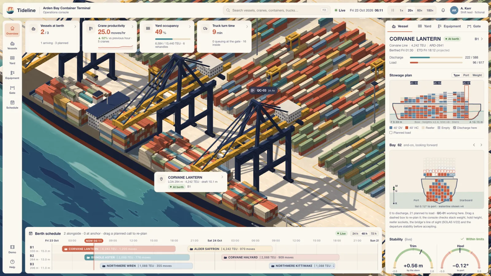

# Tideline

An operations console for a container terminal that plays like a strategy
game. A living isometric paper diorama of a fictional terminal, Arden Bay, with
ships at berth, ship-to-shore cranes swinging boxes, straddle carriers threading
the yard and trucks queuing at the gate, framed by a calm product UI: KPI cards,
a berth schedule, crane productivity, yard occupancy, and a vessel panel whose
stowage plan you can drag boxes around on while the stability readout answers.

Underneath it is a real simulation. Ship particulars come from one hull form
integrated by Simpson's rule; every box that lands or lifts changes draft,
trim, list and GM; plans that break the limits are refused with the rule
named. Every vehicle drives a path reserved cell by cell in space and time,
and a headless checker rebuilds every vehicle as a rectangle from what it
actually drove and proves, over many seeds, that nothing collides and nothing
waits for ever.



More views: [the whole terminal](preview/wide.webp) ·
[a crane lowering a box into a waiting straddle carrier](preview/detail-handover.webp) ·
[the vessel panel](preview/detail-panel.webp) · [the berth schedule](preview/detail-schedule.webp),
the details at full resolution.

| | |
| :--- | :--- |
| **Open it** | [`index.html`](index.html): no install, no server, no network, no dependencies |
| **Model** | Claude Opus 5.5 (Claude Code) |
| **Brief** | [`brief.md`](brief.md): the brief with four human-made mockups, two "continue" messages after usage-limit pauses, and five messages after delivery: the PR request, a local review, a play-test note, repository settings and one more "continue" (8 human turns) |
| **Wall clock** | 04:16 to 13:06 UTC: about 2 h 10 min of work, around two usage-limit pauses of about 6.6 h in all; then about 100 min of fixes after a play-test and reviews, around a third pause ([log, section 10](process/PROGRESS.md#10-after-delivery-a-play-test-and-local-reviews-1942-to-2055-0030-to-0055)) |
| **Full-size outputs** | release `run-tideline`: the demo tour as a film, built by the Run assets workflow ([below](#reproduce)) |
| **Process** | [`process/PROGRESS.md`](process/PROGRESS.md), [art bible](process/ART-BIBLE.md), [snapshots](process/snapshots/), [supplied mockups](process/studies/) |

## Open it

`open index.html` in a current desktop browser (Chrome, Edge, Firefox,
Safari). It needs WebGL2. The terminal starts at 06:00 on Friday 23 October
2026, part-way through two ships' calls, running at 20× real time.

| Input | Action |
| :-- | :-- |
| drag, scroll | pan, zoom |
| click a crane, carrier, truck, ship or yard block | select it; the panel and a callout follow |
| <kbd>Space</kbd>, <kbd>1</kbd>-<kbd>4</kbd> | pause; 1×, 20×, 60×, 180× |
| <kbd>⌘K</kbd> / <kbd>Ctrl K</kbd> | search ships, cranes, carriers, trucks, blocks, container numbers |
| <kbd>D</kbd> or **Demo** | a 45 s hands-off camera tour |

**Things to try**

- **Re-plan a box.** In the Vessel panel, the bay section shows boxes on board
  (solid), boxes to come off here (hatched) and boxes planned to load
  (dashed). Drag a dashed box to another slot. The console checks the stack's
  tier count and weight, the hold height under the hatch cover, reefer sockets,
  the bridge's line of sight (SOLAS V/22), whether the hatch is still open,
  and the departure stability (GM, IS Code criteria, list after anti-heel,
  trim, water under the keel at this berth). It accepts the move and shows the
  change in GM and trim, or refuses it and says why. Drag over the profile to
  reach another bay. The cranes pick the change up: a box moved to a finished
  bay brings its crane back.
- **Reassign cranes.** In the Equipment tab, give a crane to another ship.
  Cranes share one rail and cannot pass, so only a crane at the end of a group
  can go, and only if no other crane stands between; otherwise it says which
  one is in the way. A crane finishes the box it holds and any box on its way
  to it before it gantries over, and once on its way cannot be called back
  (other reassignments may rely on it). Put too many cranes on one ship and
  they get in each other's way: a crane kept out of its bays for ten minutes
  by a neighbour on the same ship hands those bays to it.
- **Reorder the berth schedule.** Drag a planned call along the time axis or
  to another berth. The Panamax does not fit berth 3 (206 m of quay, 11 m of
  water) and is refused with both reasons; a call moved onto a busy berth
  waits for the ship already there and pushes later calls back. Its exports are staged near the old berth, so the
  carriers drive further.
- **Watch the ship respond.** The profile shows the waterline (trim drawn ×8),
  the bay section shows K, G and M and the waterline (list drawn ×4); the
  gauges show their limits. As boxes land the ship lists slightly until the
  anti-heel pumps catch up.

## How it is made

| File | What it is |
| :-- | :-- |
| [`src/hull.js`](src/hull.js) | parametric hull; hydrostatic table by Simpson's rule (displacement, KB, BM, LCB, LCF, TPC, MCTC) |
| [`src/stability.js`](src/stability.js) | loading condition to drafts, trim, list, GM with free-surface correction; cross curves by integrating the heeled hull; IS Code 2008 criteria |
| [`src/vessel.js`](src/vessel.js) | three ship classes from principal dimensions only; the bay plan is what fits in the hull; lightship and tanks |
| [`src/stowage.js`](src/stowage.js) | containers (ISO 6346 check digits), arrival conditions, the auto planner, the rules a re-plan must pass |
| [`src/mapf.js`](src/mapf.js) | footprints, the reservation table, SIPP search, token passing |
| [`src/layout.js`](src/layout.js) | the terminal: berths, rails, yard blocks, transfer bays, gate; the carrier and truck graphs; the well-formedness check |
| [`src/crane.js`](src/crane.js), [`src/sim.js`](src/sim.js) | crane kinematics; the terminal, second by second; player actions |
| [`src/gl.js`](src/gl.js), [`src/render.js`](src/render.js), [`src/models.js`](src/models.js), [`src/decals.js`](src/decals.js) | the WebGL2 renderer, the models built from boxes, painted lettering |
| [`src/ui.js`](src/ui.js), [`src/panel.js`](src/panel.js), [`src/schedule.js`](src/schedule.js), [`src/icons.js`](src/icons.js), [`src/demo.js`](src/demo.js) | the console |
| [`tools/check.js`](tools/check.js) | the headless collision / liveness / stability checker |
| [`tests/`](tests/) | unit tests: hydrostatics against a box barge, planner guarantees, stowage rules, the sim |
| [`verify.mjs`](verify.mjs) | browser verification with real pointer events |

### Stability, from first principles

The same half-breadth function y(x, z) is integrated for the hydrostatics,
used to find the slots that fit in each hold, and meshed for the renderer, so
LOA, beam, capacity and displacement cannot contradict each other. The
Panamax comes out at 294.0 × 32.2 m, 4,242 TEU in 16 bays, 56,900 t
deadweight, block coefficient 0.68: in line with real ships of that size
(the mockup's 366 m ship of 8,492 TEU was not).

Methods, as in Barrass and Derrett, *Ship Stability for Masters and Mates*
(7th ed., 2012) and Rawson and Tupper, *Basic Ship Theory* (5th ed., 2001):
displacement and centres from Simpson's rule; mean draft from the
hydrostatic table; trim = W (LCB − LCG) / (100 MCTC) shared about the LCF;
GM = KB + BM − KG − FSC with FSC = Σ i ρ / W; righting levers from cross
curves (KN) computed by integrating the heeled hull at constant displacement;
list where GZ equals the heeling lever, which is Barrass's tan θ = GG₁ / GM at
small angles; the IMO Intact Stability Code 2008 (MSC.267(85)) Part A 2.2
criteria. The hydrostatics are tested against a rectangular barge, where every
quantity has a closed form (`tests/hull.test.js`).

Operations add what a terminal sees: anti-heeling tanks that pump at a
limited rate (800 t/h) starting at 0.35° of list; trim ballasting between the
peak tanks; a crane will not lift or land a box that would take the ship past
its operating limits (list 2°, GM 0.15 m, trim 2 m, under-keel clearance) and
holds instead; boxes for this port always arrive on top of their stacks, and
a hold opens only once its deck is clear.

### Vehicles that cannot collide or deadlock

Straddle carriers (10 × 5 m) and trucks (16.5 × 2.6 m) drive on graphs over a
grid of 6.5 m cells. Each pose has a footprint (the cells its rectangle
covers, plus 0.3 m) and each motion a sweep. The planner is **token passing**
for lifelong pickup and delivery (H. Ma, J. Li, T. K. S. Kumar and S. Koenig,
AAMAS 2017): one vehicle plans at a time against everyone's reserved
intervals, searching with **SIPP**, safe-interval path planning (M. Phillips
and M. Likhachev, ICRA 2011), over a reservation table in the manner of
cooperative pathfinding (D. Silver, AIIDE 2005). Reserved intervals are
closed, so two vehicles never hold a cell at the same instant: no collisions
by construction. Every plan ends in a parking pocket that no other route
sweeps, which makes the layout **well-formed** in the sense of M. Čáp,
J. Vokřínek and A. Kleiner (ICAPS 2015): a vehicle in its pocket can always
wait until every other plan has finished and then drive through an empty
network, so a plan always exists and nothing waits for ever. The layout's
well-formedness is checked when it is built.

The checker does not trust any of that. `node tools/check.js --seeds 24
--hours 6 --monkey` reruns the terminal over many seeds with random player
actions (re-plans, schedule moves, crane reassignments every ten minutes),
rebuilds every carrier and truck as its real rectangle every 0.25 s from the
trajectories they drove, tests every pair with the separating-axis theorem,
tests carriers against crane legs and against any spreader below carrier
height, and fails on any task older than 90 minutes, any carrier waiting
more than 15 minutes in a lane, any stretch of 30 minutes without a crane
move while work waits, any ship outside its limits, and any ship sailing
outside them. The only overlaps allowed are a carrier straddling a trailer
while the truck stands still in its bay, and a spreader over the carrier
taking or delivering that very box. It also fails on any crane with work that
goes 30 minutes without a move, and on any ship, alongside or under way,
whose hull touches the quay, the breakwater or another ship. Ships keep
clear of each other by a harbour rule: one ship moves at a time, so a ship
ready to sail waits alongside and one due in waits at anchor, in a fixed
slot of a single anchorage column it can leave without passing another.

### The look

The art bible ([`process/ART-BIBLE.md`](process/ART-BIBLE.md)) reconciles the
four supplied mockups: Nexus Port for the paper palette, cut-paper water and
chunky cranes; HarborView for the information architecture; the vessel-panel
close-up for the components; the crane close-up for the motion. Everything is
drawn by a WebGL2 renderer written for this run: instanced boxes with a
per-instance matrix and a material code (container corrugation, windows,
truss bracing), hulls meshed from the hull form, ground markings painted
analytically in a shader, layered cut-paper water, soft shadows from a 4096²
shadow map. Icons are path data in code; lettering is painted onto a canvas
atlas. Nothing is loaded from the network.

## Reproduce

```bash
open index.html                          # the console
node --test tests/*.test.js              # unit tests (23)
node tools/check.js --seeds 24 --hours 6 --monkey
node tools/check.js --seeds 6 --hours 30 # every call in the schedule comes alongside
(cd ../.. && npm ci && npx playwright install chromium)
node verify.mjs                          # browser verification
FFMPEG=ffmpeg node tools/film.mjs        # the demo film, output/tideline_demo.mp4
```

The Run assets workflow builds the film from the committed source with the
`imageio-ffmpeg` wheel's encoder; see `run.toml`.

## Process notes and limitations

What I verified: the unit tests; the checker (results in
[`process/PROGRESS.md`](process/PROGRESS.md)); the browser verification;
screenshots at every checkpoint compared side by side with the mockups
([`process/snapshots/`](process/snapshots/)).

What is simplified or missing:

- **Stability** neglects trim when heeling, hull shear force and bending
  moment, lashing forces, wind heeling and the weather criterion; the cross
  curves use the hull to the main deck (no buoyancy from hatch coamings or
  deck cargo). Hatch covers are not lifted or stacked. All boxes are 40 ft.
- **Operations**: no twin lifts, no crane breakdowns, no shift changes, no
  reefer monitoring. Trucks' arrivals are random rather than booked. Rehandles
  happen and are counted, but the yard allocation is simple.
- **Speeds** are typical published figures, not those of any real crane or
  carrier model. Gate turn times come out short (under 15 minutes) compared
  with real terminals, because nothing here queues trucks for appointments.
- Ships, lines, ports, people and visit references are fictional. The user
  shown in the top bar is a placeholder.
- The renderer uses a software GPU in headless tests; on real hardware it
  should be faster, but I have only measured it under SwiftShader.
